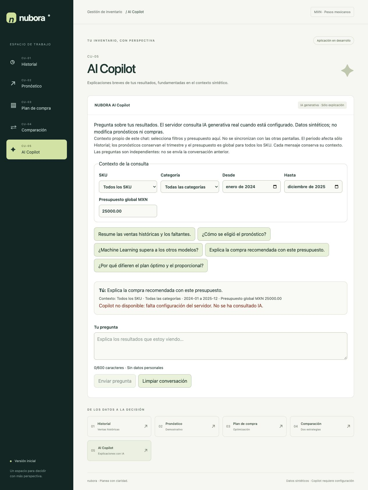
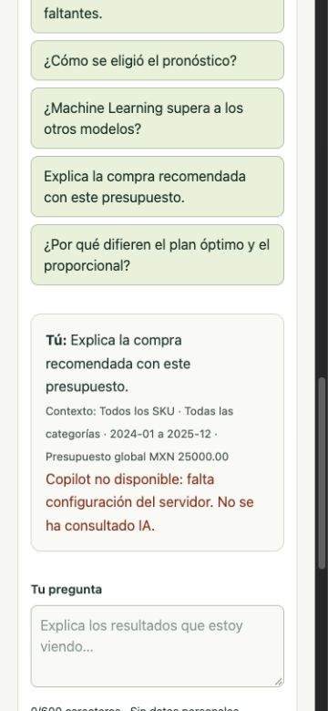

# CU-05 · NUBORA AI Copilot

Chat de explicación, con llamadas **reales** a Google Gemini API mediante el SDK oficial `@google/genai` desde `server/web-entry.ts` (entrada Web, empaquetada como función Node de Vercel). No hay respuestas IA locales pregrabadas ni fallback simulado. El frontend sólo conoce `/api/copilot`; la clave nunca se importa desde `src` ni usa prefijo `VITE_`.

## Configurar en Vercel

1. Importar el repositorio, seleccionar la rama del PR como Preview. `vercel.json` usa `framework: null` (Other) y `npm run build`: Vite sigue compilando la SPA y un paso explícito genera `.vercel/output` con Build Output API v3. No activar un override de Output Directory a `dist` en el proyecto: debe consumirse `.vercel/output/config.json`, que publica la SPA y `/api/copilot`. La función declara Node 22 y duración máxima de 20 segundos. No modificar Production para esta revisión. Instalar con `npm ci`.
2. En Settings → Environment Variables, verificar **sólo para el servidor**:
   - `GEMINI_API_KEY`: única clave del proveedor, leída explícitamente desde `process.env.GEMINI_API_KEY` en el servidor. Ya está configurada por el propietario en Preview y Production; no copiar ni mostrar su valor. No escribirla en el repositorio, chat ni capturas.
   - `GEMINI_MODEL`: opcional; predeterminado `gemini-2.5-flash-lite`. Modelo de texto con salida JSON estructurada y presupuesto de pensamiento configurable; también puede usarse `gemini-2.5-flash`. Ambos figuran con nivel gratuito en la documentación consultada; la disponibilidad, cuotas y facturación dependen del proyecto/región y pueden cambiar. No existe fallback a un modelo de pago. El modo de facturación de la cuenta no se decide desde el código.
   - `COPILOT_ENABLED=true`: interruptor explícito. Cualquier otro valor deshabilita llamadas.
   - `COPILOT_ORIGIN`: origen exacto del despliegue, sin barra final, por ejemplo `https://tu-preview.vercel.app`. Actualizarlo cuando cambie el dominio Preview y volver a desplegar. No admite comodines ni orígenes de terceros.
3. Desplegar Preview y consultar CU-05. Comprobar en Network que la respuesta es 200, contiene `answer`, `sources` y el modelo configurado; confirmar que la clave nunca aparece en peticiones del navegador. No incluir secretos en evidencias.
4. Configurar límites de gasto/cuota en el proyecto Gemini del proveedor y reglas de rate limiting/WAF en Vercel antes de abrirlo a tráfico público. El limitador en memoria es básico y NO es una cuota monetaria global.
5. Para deshabilitar, establecer `COPILOT_ENABLED=false` y redesplegar.

Para verificar empaquetado local ejecutar `npm run build` y `npm run test:runtime`, sin credenciales. El artefacto de despliegue es `.vercel/output`; usar la CLI oficial `vercel build`/`vercel deploy --prebuilt` sólo con un proyecto Preview autorizado (nunca `--prod` en esta revisión). `npm run dev` y `npm run preview` de Vite sirven sólo la SPA: sin función mostrarán indisponibilidad, nunca una respuesta falsa. No se requiere desplegar para ejecutar las pruebas con proveedor simulado.

## Contexto y funcionamiento

`src/copilot/context.ts` llama a `createDataset()`, `analyzeHistory()`, `analyzeForecast()`, `preparePurchaseData()` y `buildComparison()`. El servidor reconstruye todo desde el fixture; rechaza contextos/cifras enviados por el navegador. Reutiliza el JSON ML sólo si coincide su firma.

CU-05 tiene controles propios y visibles; no lee ni cambia estados privados de CU-01–CU-04. El periodo afecta sólo historial. SKU/categoría filtran historial/pronósticos y filas de compras. Presupuesto/indicadores de optimización y comparación siguen siendo globales para todos los SKU elegibles; métricas ML son globales. Cada mensaje guarda una copia de filtros/presupuesto para evitar confundir respuestas al cambiar controles. Las consultas son independientes: no se envía la conversación anterior; para seguimientos indicar explícitamente la pregunta.

El proveedor recibe pregunta y contexto, con instrucciones de explicar y reconocer información ausente. No recibe herramientas, claves dentro del prompt ni permisos de acción. Se solicitan dos a cuatro textos breves; el servidor añade siempre la advertencia de datos sintéticos (objetivo: tres a cinco oraciones). Cada texto debe citar hojas con `{{ruta}}`; el servidor rechaza referencias desconocidas, cifras literales, HTML/enlaces y respuestas excesivas. Las cifras se sustituyen por valores exactos del motor y se muestran fuentes desplegables. Importes `spentMXN`/`remainingMXN` ya están formateados; los campos `*Cents` están en centavos.

**Límite de fundamentación:** la sustitución garantiza procedencia de valores referenciados, no veracidad semántica absoluta de la prosa. Un LLM puede interpretar mal una relación o escribir cantidades con palabras pese al prompt. Deben revisarse las fuentes y no usar la explicación como autorización de compra. El modelo nunca actualiza decisiones ni recalcula cantidades. Se conserva el motor operativo y el ML informativo.

## Límites y privacidad

- POST JSON, mismo origen configurado, cuerpo máximo 4096 bytes (también se cuentan chunks), pregunta 600 caracteres; validación estricta de SKU, categoría, periodo y presupuesto.
- Diez consultas por minuto y dos concurrentes **por instancia**, contador global sin guardar IP/preguntas; puede reiniciarse en cold starts y multiplicarse al escalar. Origin mitiga llamadas desde otros sitios, no autentica clientes ni bloquea scripts externos que falsifiquen cabeceras. Para uso público aplicar WAF/cuotas del proveedor; no se añade autenticación ni almacenamiento.
- SDK con `maxOutputTokens:700`, `thinkingBudget:0` (sin consumir la salida en razonamiento), una candidata y sin reintentos (`httpOptions.retryOptions.attempts:1`); salida JSON por `responseMimeType`/`responseJsonSchema`. Se rechaza bloqueo de seguridad, final distinto de STOP, JSON vacío/inválido o excesivo. Salida máxima 700 tokens, contexto acotado al fixture de veinte SKU, sin historial de conversación ni reintentos automáticos. Tiempo proveedor 15 s, navegador 18 s; Cancelar aborta la espera del navegador, no garantiza anular tokens ya procesados por el proveedor.
- Deshabilitado por defecto; falta de configuración → 503. Entrada → 400/413/415, origen → 403, límite → 429, proveedor/respuesta no verificable → 502, timeout → 504. Sin propagar mensajes internos o secretos del proveedor.
- No hay logs de preguntas, claves, respuestas ni datos sensibles en nuestro código; no se habilitan caché, herramientas, sesiones ni almacenamiento de conversaciones del SDK. Esto no elimina la retención del proveedor: en el nivel gratuito Google indica que los datos pueden usarse para mejorar sus productos. Revisar sus condiciones y las de Vercel. No ingresar datos personales/secretos: pregunta y contexto sintético salen al proveedor cuando se envía.
- La conversación vive sólo en memoria del componente, máximo diez consultas; no usa localStorage ni base de datos. React renderiza texto, sin HTML del modelo.

## Verificación

`npm run build`, `npm test`, `npm run lint`. Tests del contexto comparan resultados con los motores, filtros, presupuesto global, N/D, stockouts y ML. Proveedor simulado verifica éxito, configuración del SDK Gemini/clave sólo en constructor del servidor, JSON estructurado y sin herramientas, métodos, origen, entradas, límites de bytes, cuota, concurrencia, timeout, errores, rechazo y referencias inválidas. Tests del chat cubren navegación, preguntas sugeridas, controles, fuentes, indisponibilidad, errores, cancelación y limpieza.

El propietario confirmó que `GEMINI_API_KEY` existe en Vercel para Preview y Production. No se consultó, solicitó ni mostró su valor. **Esta migración no ejecutó llamadas reales a Gemini ni certifica un despliegue Vercel**: las pruebas simulan el SDK explícitamente. Las capturas existentes conservan la interfaz sin cambios y muestran indisponibilidad, no una respuesta de IA inventada. Tras redesplegar, comprobar Preview según el paso 3 para validar modelo/cuotas/cuenta.

Referencias consultadas: [SDK oficial Gemini](https://googleapis.github.io/js-genai/release_docs/interfaces/types.GenerateContentConfig.html), [nivel gratuito y precios](https://ai.google.dev/gemini-api/docs/pricing) y [funciones Node de Vercel](https://vercel.com/docs/functions/runtimes/node-js).

Validación de la migración: `npm install @google/genai` y `npm ci` (260 paquetes instalados, 261 auditados, 0 vulnerabilidades), `npm run build` (35 módulos), `npm test` (**169 pruebas en 12 archivos**) y `npm run lint`, todos código 0. `package-lock.json` actualizado. Tests sin tráfico al proveedor. Búsqueda del bundle `dist` sin variables de clave ni SDK/endpoint Gemini. Se conserva la UI y las capturas de escritorio/móvil de la revisión inicial; no se alteraron los motores, contexto, validación de cifras ni componentes de CU-01–CU-04/ML.





## Corrección de arranque Node ESM en Vercel

**Causa reproducida:** el proyecto es ESM (`type: module`), pero `api/copilot.ts` importaba `../server/copilot` sin extensión. `moduleResolution: Bundler` acepta ese import para Vite/Vitest y `tsc --noEmit` no genera un artefacto serverless. La transpilación por archivo conserva el especificador en `api/copilot.js`; Node ESM busca literalmente `server/copilot`, sin añadir `.js`. La prueba reproduce `ERR_MODULE_NOT_FOUND` incluso cuando `server/copilot.js` sí existe. El log recibido no permite afirmar si ese archivo estaba además ausente en el despliegue original: la resolución sin extensión ya es un defecto confirmado. Añadir sólo `.js` en el primer import no resolvería todo el grafo (motores, contexto y JSON también dependen de resolución de bundler).

**Solución:** `scripts/build-server.mjs` empaqueta `server/node-entry.ts` → `server/web-entry.ts` → handler/contexto/motores/JSON/SDK y dependencias en un único `index.mjs`, usando esbuild para Node 22 ESM. No cambia la lógica de CU-01–CU-04 ni ML. `server/node-entry.ts` adapta HTTP de Node al handler Web existente, conserva streaming de entrada, cabeceras, estados y controles; el body sigue limitado por el handler. El shim `createRequire` permite imports nativos de dependencias CJS. Los addons opcionales de `ws` se desactivan en compilación mediante sus flags documentados en el paquete; usa fallback JS/Node, sin depender de binarios externos. Ninguna clave se lee o sustituye durante build.

El script rechaza imports externos que no sean módulos nativos de Node, registra un metafile privado para auditar entradas e incluye el SDK Node `@google/genai`, sus dependencias y `results.json`. La salida es:

```text
.vercel/output/
  config.json                          # rutas v3; API antes de fallback SPA
  static/                              # copia exacta de dist, sin código servidor
  functions/api/copilot.func/
    .vc-config.json                    # nodejs22.x, index.mjs, launcher Nodejs, 20s
    index.mjs                          # bundle autocontenido, no require de src ni node_modules
  copilot-build-meta.json               # entradas/tamaños, fuera de static
```

Se reemplaza la detección/transpilación implícita del preset Vite por Build Output API explícita. La antigua entrada `api/copilot.ts` se mueve a `server/web-entry.ts`, sin cambiar su lógica: no queda un directorio `api/` de fuentes que pueda disparar una segunda función automática para el mismo URL y sobrescribir/ocultar el bundle. La prueba comprueba esta condición. Vercel monta sólo el contenido de `.func`, de modo que incluir archivos sueltos fuera no bastaría. `dist` se conserva para el preview habitual de la SPA. Los artefactos `.vercel/` están ignorados; sólo se versionan código/configuración del build. No se usa `includeFiles` como parche para imports inválidos.

**Regresión:** `npm test` ejecuta las suites Vitest y luego dos tests Node (`npm run test:runtime`). Uno reproduce el error original tras transpilación TS a ESM. El otro construye con la misma función del build, comprueba inputs/manifest y copia únicamente `.func` a un directorio temporal fuera del repositorio. Un proceso Node nuevo carga el módulo sin loaders TS y sirve HTTP real local: GET 405, POST sin configuración 503, JSON inválido 400 y consulta válida con SDK real/transport simulado 502 controlado. Se usa una clave ficticia, entorno limpio y fetch simulado para el proveedor: no hay tráfico a Gemini. Se verifican dependencias durante carga, construcción de contexto, inicialización del SDK y transporte; esto es más amplio que importar fuentes con Vitest.

Referencias: [resolución ESM de Node](https://nodejs.org/download/release/latest-v24.x/docs/api/esm.html), [Build Output API](https://vercel.com/docs/build-output-api), [configuración de funciones Node](https://vercel.com/docs/build-output-api/primitives).

**Verificación remota ejecutada:** Vercel marcó Ready el despliegue de `bee5546` ([detalle](https://vercel.com/renese73/nubora-ia/2iSVFqtbmh4NRQXtfGopCbMLVHuh)). En el [Preview de la rama](https://nubora-ia-git-feat-cu05-ai-copilot-renese73.vercel.app) se ejecutó GET `/api/copilot` → **405** con `{"error":"Sólo se permite POST."}`, POST `/api/copilot` con Origin del Preview, Content-Type JSON y cuerpo `{}` → **400** con error de pregunta/filtros inválidos; GET `/` → **200**. Ambas rutas API ejecutan el handler sin fallo de carga ESM. El primer despliegue con `api/` fuente todavía presente devolvió 500 pese a estar Ready; al quitar la entrada autodetectada, el bundle explícito arranca correctamente.

No se envió una pregunta válida a Gemini, no se leyó su clave y no se modificó Production. La verificación remota acredita arranque y validación, no inferencia real. El panel de Vercel requiere iniciar sesión y no se consultaron logs privados; la evidencia procede del estado público del commit en GitHub y las respuestas HTTP directas del Preview.

Validación final de esta corrección: `npm ci` (262 instalados, 263 auditados, 0 vulnerabilidades), `npm run build`, `npm test` (**169 Vitest + 2 runtime = 171 pruebas aprobadas**) y `npm run lint`, todos código 0. Las dos pruebas runtime también pasaron con Node 22 real (`npm exec --yes --package=node@22 -- node --test scripts/server-runtime.test.mjs`), además del Node 24 local. Bundle: 135 entradas, 1,937,130 bytes; auditoría sin dependencias externas salvo módulos nativos. Static sin SDK ni variables de clave. Diff vacío en `src/history`, `src/forecast`, `src/purchases`, `src/comparison`, `src/copilot`, `server/copilot.ts` y `tsconfig.json`: se conserva su lógica. La entrada `api/copilot.ts` sólo se trasladó a `server/web-entry.ts`; se corrige el empaquetado/launcher por separado.
