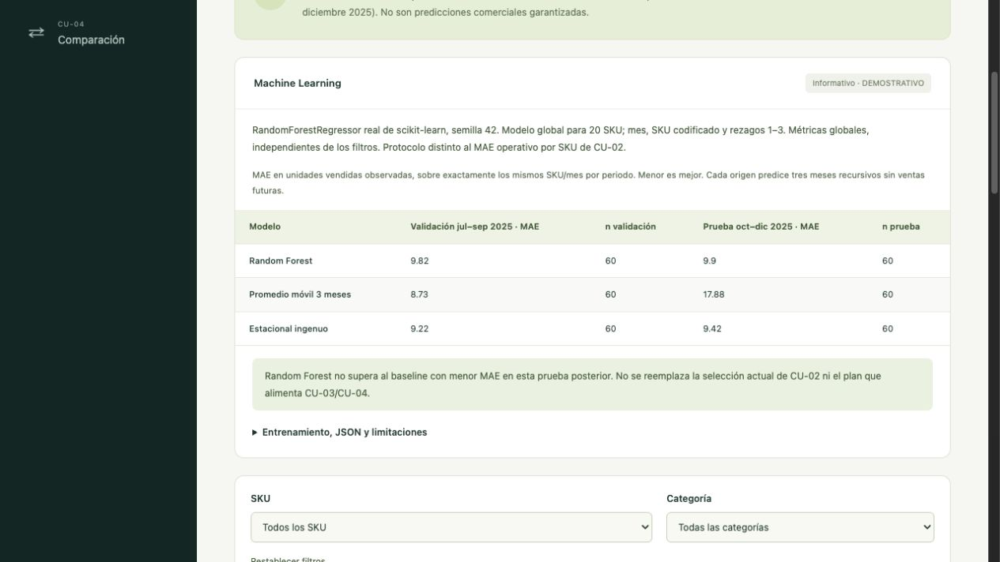
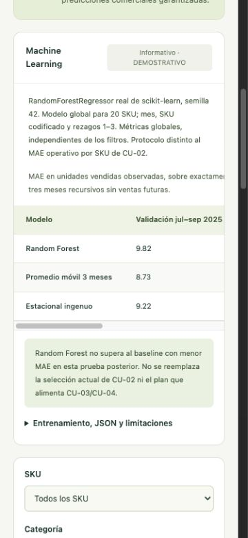

# CU-02 · Machine Learning informativo

Entrenamiento real, local y batch con **scikit-learn RandomForestRegressor**. No hay API de inferencia, base de datos ni servicio externo. El JSON se versiona para que el frontend funcione sin Python. No reemplaza `forecastProduct()` ni las decisiones que usan CU-03/CU-04.

## Reproducir (macOS/Linux)

Probado con Node.js 24.19.0, Python 3.12.14 y las versiones fijadas en `requirements.txt`. Usar Python 3.12 o posterior compatible con esas dependencias.

```sh
npm ci
python3.12 -m venv .venv
.venv/bin/python -m pip install -r ml/requirements.txt
npm run ml:export
.venv/bin/python ml/train.py
.venv/bin/python -m unittest discover -s ml -p 'test_*.py' -v
npm run build
npm test
npm run lint
```

`ml:export` llama directamente a `createDataset()` de TypeScript y escribe el archivo intermedio ignorado `work/ml-dataset.json`; no se mantiene una segunda fórmula ni un dataset manual en Python. El entrenamiento lee ese archivo y escribe `src/forecast/ml/results.json`. Ambos scripts aceptan rutas explícitas: `npm run ml:export -- --output ruta.json` y `python ml/train.py --input ruta.json --output resultados.json`. Para los tests con otra ruta, definir `ML_DATASET_PATH=ruta.json`.

El JSON contiene parámetros, versiones, firma de igualdad del dataset, SHA-256 de su representación canónica, cohorte elegible, cortes y tamaños de muestra, métricas, predicciones de evaluación auditables y los 60 pronósticos finales. No incluye fechas de ejecución variables; con los mismos datos y versiones se reproduce el mismo resultado. La firma no criptográfica detecta un dataset ajeno/desactualizado en la UI; el SHA-256 proporciona trazabilidad adicional. Vitest contrasta la firma con el generador vigente, evitando publicar un informe antiguo tras cambiar el fixture.

## Método y temporalidad

- Un bosque global para los 20 SKU: `n_estimators=160`, `max_depth=6`, `min_samples_leaf=2`, `random_state=42`, `n_jobs=1`. Parámetros fijados antes de evaluar; no se ajustan buscando un mejor resultado de prueba.
- Features: mes calendario (1–12), SKU one-hot y ventas rezagadas de 1, 2 y 3 meses. La codificación se ajusta sólo al entrenamiento de cada origen. No se usan existencias al corte, costos, promociones futuras ni indicadores futuros de faltantes como features.
- Validación: origen **2025-06**, entrenamiento con objetivos abril 2024–junio 2025: **300 filas**. Pronósticos julio–septiembre 2025: **60 objetivos comunes** (20 SKU × 3 meses).
- Prueba temporal posterior: origen **2025-09**, reajuste con objetivos hasta septiembre: **360 filas**. Pronósticos octubre–diciembre 2025: **60 objetivos comunes**. El reajuste puede usar las ventas de validación, ya observadas al nuevo corte; nunca usa los objetivos de prueba. Sin partición aleatoria.
- Cada origen predice tres pasos **recursivos**: los horizontes 2 y 3 usan estimaciones internas sin redondear; no se introduce el valor real de un mes dentro del horizonte. Los modelos base usan el mismo protocolo y sus fórmulas coinciden con las funciones de TypeScript, comprobado por tests cruzados.
- Publicación y MAE: entero no negativo al más cercano, `.5` hacia arriba para los tres métodos. MAE = suma de errores absolutos / número de objetivos compartidos. El JSON guarda los valores sin redondear de la métrica; la UI muestra hasta dos decimales.
- Entrenamiento final tras terminar la evaluación: objetivos **abril 2024–diciembre 2025**, **420 filas**; enero–marzo 2024 sólo sirven para construir rezagos. Utiliza las ventas históricas elegibles hasta diciembre de 2025 y produce **60 pronósticos para enero–marzo de 2026**, sin ventas reales futuras.

La cohorte fija requiere 24 meses válidos y únicos por SKU para comparar los mismos objetivos en los tres métodos. Se excluyen SKU incompletos/duplicados/valores inválidos sin imputar ceros y se registran las causas. Si no queda muestra, MAE es `null` (N/D), no hay pronósticos inventados y el estado es `insufficient_data`; si sólo quedan algunos SKU, es `partial`. La sección visual oculta un informe incompleto o que no corresponde al dataset actual.

## Resultados ejecutados sobre el fixture

| Modelo | MAE validación jul–sep (n=60) | MAE prueba oct–dic (n=60) |
| --- | ---: | ---: |
| Random Forest | 9.816666666666666 | 9.9 |
| Promedio móvil de 3 meses | 8.733333333333333 | 17.883333333333333 |
| Estacional ingenuo | 9.216666666666667 | 9.416666666666666 |

**Random Forest no supera al mejor baseline en la prueba posterior.** No se atribuye una mejora general ni se promociona automáticamente a producción. Estos MAE globales de dos cortes no deben confundirse con el MAE operativo por SKU y cuatro orígenes que ya muestra CU-02.

## Pruebas y limitaciones

11 tests Python ejecutados: dataset real exportado (20 SKU, 480 registros únicos, 24 meses), fechas de features, tamaños de muestra, modificación de valores futuros sin cambiar entrenamiento ni predicciones del corte, recursión sin teacher forcing, misma muestra entre modelos y MAE recalculado, formato JSON/60 salidas, reproducción exacta, datos faltantes/duplicados/NaN, ausencia de datos, ceros válidos y exclusión de ventas de 2026.

Vitest comprueba la correspondencia del artefacto con el fixture, recalcula MAE, confirma la misma muestra entre modelos, compara los baselines Python con `predict()` de TypeScript, valida el contenido informativo y oculta métricas al cambiar el dataset. Las suites existentes conservan las decisiones de CU-01/CU-03/CU-04.

Datos sintéticos y sólo dos años; un único trimestre posterior de prueba no demuestra estabilidad comercial. Los 60 objetivos están relacionados por SKU/mes, no son 60 muestras independientes. La cohorte de historia completa es retrospectiva y no simula altas de productos ni datos operativos incompletos. Los stockouts restringen ventas observadas: no se reconstruye demanda perdida. No se modelan promociones, cambios de precio ni shocks futuros. No hay intervalos de confianza ni evaluación externa. La reproducibilidad exacta se verifica en el mismo entorno fijado; otras versiones/plataformas pueden introducir diferencias numéricas.

## Capturas

Se inspeccionó el build con Vite preview en escritorio y viewport móvil de 375 × 812. La tabla conserva desplazamiento horizontal dentro de su contenedor.



